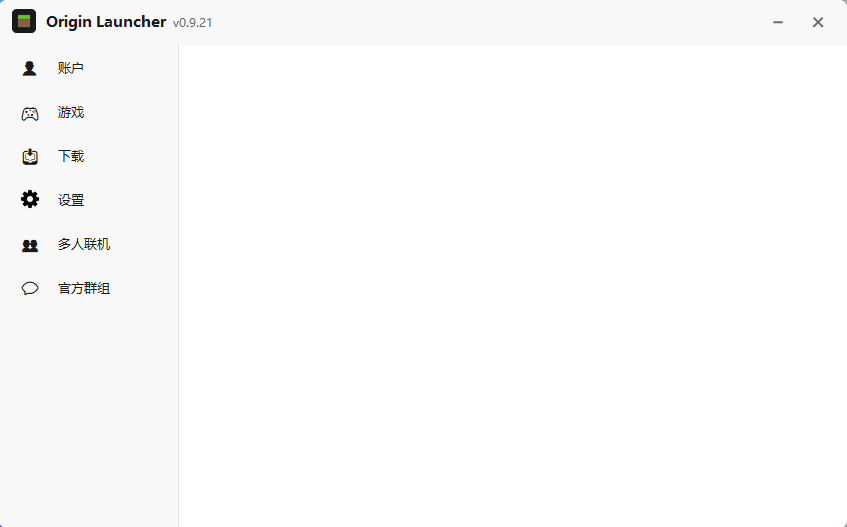

# Origin Launcher

**一款使用 Python 和 Tkinter 构建的现代、轻量级 Minecraft: Java Edition 启动器。**

[](README.md)
[](README_zh.md)

---

## ✨ 功能特性

- 🎮 **离线账户** — 只需输入昵称即可创建账户，无需登录
- 🔗 **微软正版登录** — OAuth 设备码流程，不接触密码
- 🌐 **外置登录** — 支持连接第三方验证服务器
- 📦 **一键安装版本** — 下载并管理 Minecraft 各版本
- 🎨 **原生界面** — 基于 Tkinter，支持高 DPI，无重型依赖
- ⚡ **启动迅速** — PyInstaller 打包为单个 `.exe`

## 📥 下载

前往 [Releases 页面](https://github.com/ciallo661/OriginLauncher/releases) 下载最新安装包。

| 文件 | 说明 |
|---|---|
| `OriginLauncher-Setup-vX.Y.Z.exe` | Windows 安装版（推荐） |
| `OriginLauncher.exe` | 绿色单文件版 |

> 需 Windows 10 或更高版本。无需预装 Java（运行时会随版本一起下载）。

## 🖼️ 界面截图



## 🛠️ 技术栈

- **Python 3.13** + **Tkinter** — 图形界面
- **PyInstaller** — 打包
- **Pillow** — 图标渲染
- **Inno Setup 7** — 安装脚本

## 📁 项目结构

```
mc-launcher/
├── mc_launcher.py          # 主程序
├── OriginLauncher.spec      # PyInstaller 配置
├── version_info.txt         # Windows 版本信息
├── installer.iss             # Inno Setup 脚本
└── *.png                    # UI 图标与资源
```

## 📜 开源许可

本项目仅供个人学习与交流使用。与 Mojang、Microsoft 无关。

---

<p align="center">为 Minecraft 玩家社区 ❤️ 而作</p>
